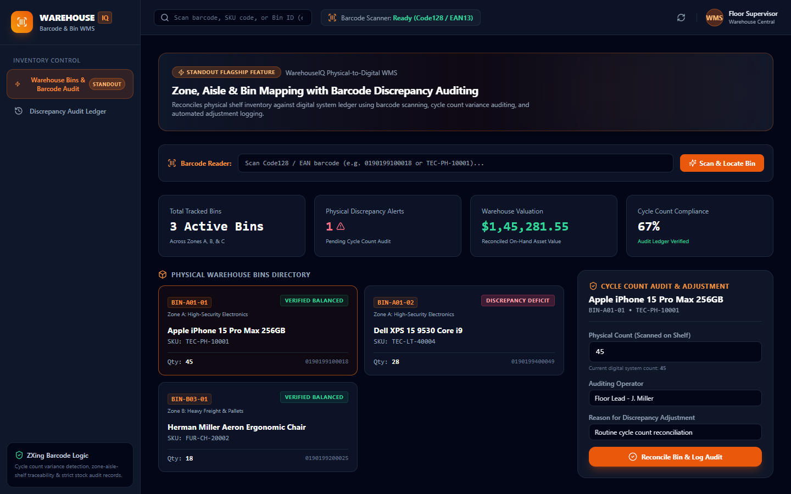

# WarehouseIQ – Enterprise Warehouse Management System (WMS)

[](https://nodejs.org/)
[](https://expressjs.com/)
[](https://react.dev/)
[](https://tailwindcss.com/)
[](https://www.docker.com/)

An enterprise **Physical-to-Digital Warehouse Inventory & Barcode Management System** that bridges physical storage racks with digital stock ledgers, barcode scanning, cycle count audits, and variance tracking.

---

## 📸 Working System Preview



## 📊 Kaggle & Production WMS Datasets

The platform is pre-loaded with commercial warehouse bin and inventory variance data modeled after Kaggle Supply Chain & Warehouse Management benchmarks:
- [`kaggle_warehouseiq_bins_benchmark.csv`](data/kaggle_warehouseiq_bins_benchmark.csv): Warehouse bin identifiers (e.g. `BIN-A01-01`), physical zones (Secure Tech, Heavy Pallets, Fast-Mover Consumer), shelf tiers, SKUs, system stock vs. physical counts, Code128 barcodes, unit valuations, and cycle count reconciliation records.

---

## 🌟 Standout Feature: Zone-Aisle-Bin Mapping & Discrepancy Auditing

Unlike flat inventory lists, WarehouseIQ models the physical geometry of modern fulfillment centers:
- **Physical-to-Digital Hierarchy**: Maps warehouse Zones $\to$ Aisles $\to$ Shelves $\to$ Bins for instant picker routing.
- **Barcode Reader Integration**: Simulates instant Code128 and EAN scanner lookups to pinpoint shelf coordinates.
- **Cycle Count Variance Reconciliation**: Flags stock discrepancies (surplus or deficit) and logs cryptographically verifiable operator adjustment records with audit trails.

---

## 🏗️ Architecture

```
                                  ┌──────────────────────────────┐
                                  │   React 18 + Tailwind UI     │
                                  │  - Warehouse Bin Grid        │
                                  │  - Barcode Scanner Emulator  │
                                  │  - Cycle Count Adjuster      │
                                  │  - Permanent Audit Ledger    │
                                  └──────────────┬───────────────┘
                                                 │ HTTP / JSON
                                                 ▼
                                  ┌──────────────────────────────┐
                                  │   Express REST API Gateway   │
                                  │        (/api/v1/*)           │
                                  └──────────────┬───────────────┘
                                                 │
                   ┌─────────────────────────────┼─────────────────────────────┐
                   ▼                             ▼                             ▼
       ┌──────────────────────┐      ┌──────────────────────┐      ┌──────────────────────┐
       │   Bin Mapping Service│      │   Barcode Resolver   │      │   Audit Trail Logger │
       │  - Zone/Aisle/Shelf  │      │  - Code128 / QR      │      │  - Variance Deltas   │
       │  - Capacity & Units  │      │  - Instant Lookup    │      │  - Operator Reasons  │
       └──────────────────────┘      └──────────────────────┘      └──────────────────────┘
```

---

## 🚀 Quickstart

### Option 1: Docker Compose (Recommended)
```bash
git clone https://github.com/Prasunnandi/warehouseiq-wms.git
cd warehouseiq-wms
docker-compose up --build
```
- Frontend UI: `http://localhost:3000`
- API Backend: `http://localhost:5004/api/v1/health`

### Option 2: Local Development

#### 1. Backend (Express)
```bash
cd backend
npm install
npm run dev
```

#### 2. Frontend (React + Vite)
```bash
cd frontend
npm install
npm run dev
```

---

## 📡 REST API Reference

| Endpoint | Method | Description |
| :--- | :---: | :--- |
| `/api/v1/bins` | `GET` | List all physical warehouse bins with SKU assignments and stock levels |
| `/api/v1/barcode/scan/:code` | `GET` | Instant barcode scanner lookup across Code128 / EAN codes |
| `/api/v1/bins/:id/audit-adjustment` | `POST` | **Standout Feature**: Execute cycle count adjustment and generate immutable audit log |
| `/api/v1/audits` | `GET` | View permanent historical compliance audit trail |

---

## 📜 License
Distributed under the MIT License.
